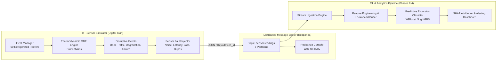

# FrostGuard (ColdChainIQ) ❄️🚛

[](https://www.python.org/downloads/)
[](https://redpanda.com/)
[](https://opensource.org/licenses/MIT)

**ColdChainIQ** is an end-to-end telemetry and predictive excursion detection platform designed for pharmaceutical and perishable cold chain logistics. 

It pairs an IoT reefer container digital twin (incorporating 1st-order thermodynamic differential equations, thermostat hysteresis, vehicle dynamics along major Indian highway freight corridors, and stochastic mechanical failures) with real-time Kafka event streaming and supervised early-warning ML pipelines.

---

## Architecture Overview



---

## Key Features

1. **High-Fidelity Thermodynamic Digital Twin**:
   - Explicit first-order Euler integration modeling ambient conductive heat leak ($18.0\ \text{W/K}$), door opening convective displacement ($180.0\ \text{W/K}$), solar highway gain, and compressor cooling curves.
   - Core-to-air thermal mass buffering across 4 specialized cargo profiles: **Vaccines** ($2^\circ\text{C} - 8^\circ\text{C}$), **Frozen Foods** ($-25^\circ\text{C} - -18^\circ\text{C}$), **Dairy** ($1^\circ\text{C} - 4^\circ\text{C}$), and **Fresh Produce** ($4^\circ\text{C} - 10^\circ\text{C}$).
   - Per-truck structural heterogeneity ($\pm 12\%$ insulation/compressor variance) and unobserved latent factors (gasket seal wear, cargo load factor).

2. **Realistic Operational Failure Modes & Hard Negatives**:
   - **Door Infiltration**: Lognormal duration tails at stops calibrated so that short openings (1–5 min) remain true hard negatives, with an overall excursion rate of ~5%.
   - **Compressor Degradation**: Gradual power-law degradation providing learnable precursor patterns before complete failure.
   - **Sudden Compressor Failures**: Calibrated to ~35% of failure events to cap recall boundaries realistically.
   - **Traffic Jams & Heat Soak**: Low-speed idle heat soak and underbody asphalt radiation along highway transit routes.
   - **Pre-Cooling Variance**: Incomplete initial warehouse precooling with mild offsets where many recover naturally.

3. **Event Streaming & Edge Fault Simulation**:
   - Streams telemetry at configurable time scales (e.g. 60x real-time) to a 6-partition Redpanda topic partitioned deterministically by `device_id`.
   - Real-world sensor network anomalies: dropped telemetry packets (~2.7%), network latency / out-of-order delivery (~1%), and transmission duplicates (~0.5%).

4. **100% Deterministic Reproducibility**:
   - Master deterministic RNG splitting via `numpy.random.SeedSequence(seed).spawn(N)` guaranteeing identical bit-for-bit results across runs with the same seed.

---

## Directory Structure

```text
FrostGuard/
├── data/
│   └── raw/                   # Generated historical datasets (Parquet, CSV, Summary)
├── docs/                      # Validation reports and diagnostic figures
│   ├── ambient_vs_excursions.png
│   ├── door_vs_excursion.png
│   ├── truck_timeline.png
│   └── validation_report.md
├── services/
│   └── simulator/             # IoT Sensor Simulator & Telematics Generator
│       ├── Dockerfile
│       ├── PHYSICS.md         # Detailed physical equations and constant justifications
│       ├── README.md          # Simulator-specific operational documentation
│       ├── requirements.txt
│       ├── scripts/
│       │   └── verify_phase1.py # Automated QA audit and verification suite
│       ├── src/simulator/     # Core simulator package
│       │   ├── cargo_profiles.py
│       │   ├── cli.py         # Typer CLI (batch & live streaming commands)
│       │   ├── config.py
│       │   ├── environment.py
│       │   ├── events.py
│       │   ├── faults.py
│       │   ├── fleet.py
│       │   ├── models.py      # Pydantic schema contracts (SensorReading, GroundTruthEvent)
│       │   ├── physics.py     # Thermal ODE engine
│       │   ├── routes.py      # Indian highway routes with GPS waypoints
│       │   ├── sinks.py       # Parquet, CSV, and Kafka sinks
│       │   └── truck.py
│       └── tests/             # Pytest test suite (11 unit and integration tests)
├── docker-compose.yml         # Redpanda broker + Redpanda Console stack
├── .env.example
└── README.md
```

---

## Quickstart Guide

### 1. Prerequisites
- Python 3.11+
- Docker and Docker Compose

### 2. Environment Setup
```bash
# Clone the repository
git clone https://github.com/im-abhyuday/FrostGuard.git
cd FrostGuard

# Create and activate virtual environment
python -m venv .venv
source .venv/bin/activate  # On Windows: .venv\Scripts\activate

# Install simulator dependencies
pip install -r services/simulator/requirements.txt
```

### 3. Launch Local Message Broker (Redpanda)
```bash
docker compose up -d redpanda
```
- **Kafka Endpoint**: `localhost:9092` (external), `redpanda:29092` (internal Docker)
- **Redpanda Admin API**: `http://localhost:9645`
- **Redpanda Web Console**: `http://localhost:8080`

### 4. Run Automated QA Audit Suite
```bash
python services/simulator/scripts/verify_phase1.py --all
```

### 5. Generate Historical Dataset (Batch Mode)
Generate 30 days of 1-minute telemetry across a fleet of 50 trucks (2.1+ million readings):
```bash
python -m simulator.cli batch --trucks 50 --days 30 --seed 42 --out-dir ./data/raw
```

Artifacts produced in `./data/raw/`:
- `readings.parquet`: Full telemetry dataset (~2.11M rows).
- `readings_sample.csv`: Sample CSV for quick exploration.
- `ground_truth_events.parquet`: Ground-truth root cause tags for supervised ML.
- `shipments.csv`: Shipment metadata records.
- `dataset_summary.json`: Statistical distribution and class balance verification.

### 6. Run Real-Time Streaming Telemetry (Live Mode)
Stream live sensor telemetry to Redpanda at 60x speed (1 real second = 1 simulation minute):
```bash
python -m simulator.cli live --trucks 10 --time-scale 60.0 --kafka-bootstrap localhost:9092
```

Inspect incoming messages using the Redpanda CLI:
```bash
docker exec -it coldchain-redpanda rpk topic consume sensor.readings -n 5
```

---

## Diagnostic Visualizations

Diagnostic plots are automatically generated in [`docs/`](docs/) during batch validation runs:

- **Fleet Timeline**: Container internal air temperature, ambient temperature, door status, and compressor cycles across a 48-hour transit window.
- **Door Infiltration vs Risk**: Binned duration risk breakdown (`1-2 min`, `2-5 min`, `5-10 min`, `>10 min`) confirming short openings remain hard negatives while extended openings trigger excursions.
- **Diurnal Ambient Thermal Response**: Ambient exterior temperature fluctuation vs diurnal excursion risk across day and night cycles.

---

## Schema Contracts

### `SensorReading` (Emitted to Kafka topic `sensor.readings`)
| Field | Type | Description |
| :--- | :--- | :--- |
| `schema_version` | `str` | `"1.0"` semantic schema version |
| `event_id` | `str` | UUID4 string unique per emission |
| `shipment_id` | `str` | Shipment identifier (e.g. `SHP-0001-0001`) |
| `device_id` | `str` | Sensor device hardware ID (used as Kafka message key) |
| `timestamp` | `str` | ISO-8601 UTC timestamp |
| `temperature_c` | `float` | Container air temperature ($^\circ\text{C}$) |
| `humidity_pct` | `float` | Relative humidity ($0\% - 100\%$) |
| `door_open` | `bool` | Door open sensor state |
| `compressor_on` | `bool` | Active refrigeration circuit relay |
| `compressor_status`| `enum` | `OK`, `DEGRADED`, or `FAILED` |
| `ambient_temp_c` | `float` | Exterior highway ambient temperature |
| `latitude`, `longitude` | `float` | WGS-84 GPS coordinates along highway corridor |
| `speed_kmph` | `float` | Vehicle ground speed |
| `cargo_type` | `enum` | `VACCINE`, `FROZEN_FOOD`, `DAIRY`, `FRESH_PRODUCE` |
| `setpoint_c` | `float` | Target thermostat temperature |
| `battery_pct` | `float` | Sensor telematics battery level |

---

## Port Allocation Table

| Service | Container Port | Host Port | Protocol / Listener | Used By |
| :--- | :--- | :--- | :--- | :--- |
| **Redpanda (Kafka)** | `29092` | *None* | `PLAINTEXT` (Internal) | Docker network simulator (`redpanda:29092`) |
| **Redpanda (Kafka)** | `9092` | `9092` | `OUTSIDE` (External) | Host CLI and local producers (`localhost:9092`) |
| **Redpanda (Admin)** | `9644` | `9645` | `HTTP / Admin API` | Cluster health / `rpk` administration |
| **Redpanda Console** | `8080` | `8080` | `HTTP (Web UI)` | Web browser topic/message inspector (`http://localhost:8080`) |

---

## License

This project is licensed under the MIT License - see the LICENSE file for details.
