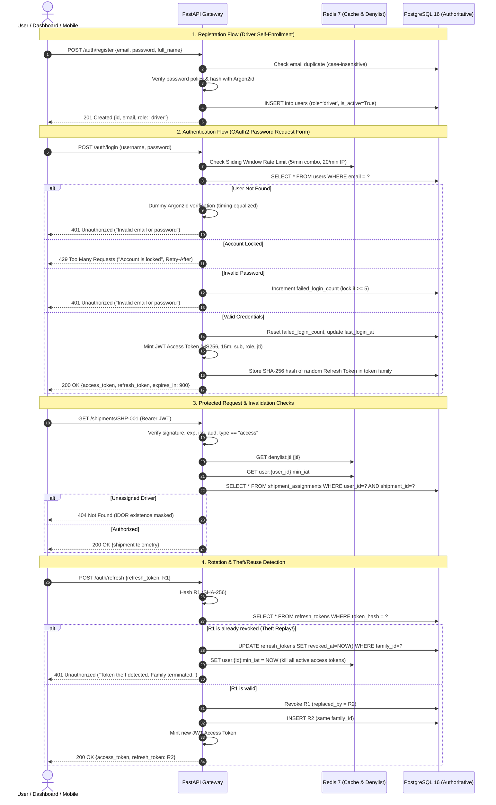

# ColdChainIQ API: Authentication, JWT & Role-Based Access Control (RBAC) 🔐

[](https://fastapi.tiangolo.com)
[](https://datatracker.ietf.org/doc/html/rfc7519)
[](https://www.postgresql.org/)
[](https://redis.io/)
[]()

The `services/api` service provides the secure authentication foundation, JWT lifecycle management, object-level authorization, and administrative governance for the ColdChainIQ platform. It serves fleet telematics, alert acknowledgements, and will power real-time WebSockets and RAG copilot services in subsequent phases.

---

## 1. Authentication & Token Flow



---

## 2. Permission Matrix (RBAC)

The platform enforces three strict roles with zero privilege overlap:

| Resource / Endpoint | Method | Driver | Quality Auditor | Operations Manager | Authorization Enforcement Mechanism |
|---|:---:|:---:|:---:|:---:|---|
| `/auth/login`, `/auth/register` | `POST` | Public | Public | Public | Unauthenticated allowlist |
| `/auth/refresh` | `POST` | Public | Public | Public | Opaque token rotation + reuse detection |
| `/users/me` | `GET` | ✅ Profile | ✅ Profile | ✅ Profile | `get_current_user` |
| `/users/me` | `PATCH` | ✅ Name only | ✅ Name only | ✅ Name only | `get_current_user` |
| `/users/me/change-password` | `POST` | ✅ Active sessions killed | ✅ Active sessions killed | ✅ Active sessions killed | Requires current pwd + kills refresh family |
| `/shipments` | `GET` | ⚠️ **Own assigned only** | ✅ Fleet-wide | ✅ Fleet-wide | Object-level query filter on `shipment_assignments` |
| `/shipments/{id}` | `GET` | ⚠️ **200 (if assigned) / 404 (if not)** | ✅ 200 | ✅ 200 | `get_shipment_for_user` dependency (IDOR-safe) |
| `/shipments/{id}/readings` | `GET` | ⚠️ **200 (if assigned) / 404 (if not)** | ✅ 200 | ✅ 200 | `get_shipment_for_user` dependency (IDOR-safe) |
| `/alerts/{id}/ack` | `POST` | ⚠️ **Assigned only** | ❌ **403 Forbidden** | ✅ Fleet-wide | `require_role("driver", "manager")` + assignment check |
| `/admin/users` | `GET` | ❌ **403 Forbidden** | ❌ **403 Forbidden** | ✅ All users | `require_role("manager")` |
| `/admin/users/{id}/role` | `PATCH` | ❌ **403 Forbidden** | ❌ **403 Forbidden** | ✅ (Not self) | Manager-only; bumps `min_iat` in Redis; self-protected |
| `/admin/users/{id}/active` | `PATCH` | ❌ **403 Forbidden** | ❌ **403 Forbidden** | ✅ (Not self) | Manager-only; bumps `min_iat` in Redis; self-protected |
| `/admin/assignments` | `POST` / `DELETE`| ❌ **403 Forbidden** | ❌ **403 Forbidden** | ✅ Manage drivers | Manager-only; audit log written to PostgreSQL |

---

## 3. Token Lifecycle & Security Hardening

### 3.1 Access Tokens (JWT)
- **Algorithm**: `HS256` signed with a cryptographically secure 256-bit+ secret.
- **Lifetime**: 15 minutes default (`ACCESS_TOKEN_MINUTES=15`).
- **Claims**:
  - `sub`: User UUID string
  - `role`: Role enum string (`driver`, `manager`, `auditor`)
  - `jti`: Random UUID identifying the token instance
  - `iat`: Timestamp of issuance (epoch seconds)
  - `exp`: Expiration timestamp (`iat + 900`)
  - `type`: Explicit token type guard (`"access"`)
  - `iss`: Authoritative issuer (`"coldchainiq-api"`)
  - `aud`: Authorized audience (`"coldchainiq-clients"`)
- **Revocation**: Added to Redis denylist `denylist:{jti}` with TTL equal to remaining lifetime on explicit `/auth/logout`.

### 3.2 Refresh Tokens (Opaque + Rotation + Theft Detection)
- **Token Format**: High-entropy 48-byte URL-safe string (`secrets.token_urlsafe(48)`).
- **Storage**: Only SHA-256 hashes are persisted in the database; raw strings are never stored.
- **Lineage Family**: Each refresh token belongs to a `family_id` (UUID).
- **Rotation**: Presenting an active refresh token issues a brand-new token and immediately revokes the old token with a pointer (`replaced_by`).
- **Reuse Detection**: If a previously revoked refresh token is presented again (indicating token interception or replay attack):
  1. The entire token family is immediately revoked in PostgreSQL.
  2. The user's active session timestamp is bumped in Redis (`user:{user_id}:min_iat = now`), instantly invalidating all outstanding JWT access tokens.
  3. Returns `401 Unauthorized` with error code `TOKEN_THEFT_DETECTED`.

### 3.3 Account Lockout & Brute-Force Defense
- **Database Lockout**: 5 consecutive failed login attempts locks the account in PostgreSQL for 15 minutes (`locked_until = now + 15m`).
- **Sliding-Window Rate Limiter**: Redis ZSET sliding log enforces:
  - `/auth/login`: 5 requests/min per IP+email combo, 20 requests/min per IP.
  - `/auth/register`: 5 requests/hour per IP.
  - `/auth/refresh`: 30 requests/min per IP.
- **Fail-Open Strategy**: If Redis is unreachable, the rate limiter fails open with structured error logs; the PostgreSQL account lockout backstop prevents brute-force account compromise.

---

## 4. Threat Model & Mitigations

| Threat Vector | Attack Scenario | ColdChainIQ Mitigation |
|---|---|---|
| **Account Enumeration on Register** | Attacker probes `/auth/register` to discover registered emails. | **Anti-Enumeration Protection (FIX 1)**: Returns HTTP 202 Accepted with generic body `"If this email can be registered, the account has been created. You can now sign in."` on both new and existing emails. Duplicate path computes dummy Argon2id hash to equalize response latency (<10% diff). Database functional index `uq_users_email_ci ON (lower(email))` serves as authoritative race safety net. |
| **Credential Stuffing / Brute Force** | Rapid automated password guessing on `/auth/login`. | Dual-layer: Redis sliding window (5/min per combo, 20/min per IP) + PostgreSQL account lockout (5 failures = 15m lock). |
| **User Enumeration / Timing Attacks** | Measuring response latency to deduce whether an email exists on login. | Generic error `"Invalid email or password"` for all failures; executes dummy Argon2id hash verification when user does not exist. |
| **Insecure Direct Object Reference (IDOR)** | Driver guessing another shipment ID (`/shipments/SHP-999`). | `get_shipment_for_user` dependency queries driver assignments; returns **404 Not Found** (never 403), masking resource existence. |
| **Refresh Token Theft & Replay** | Attacker intercepts a rotated refresh token and replays it. | Token family lineage tracking: reuse of any revoked token revokes the entire family, increments DB `token_version`, and bumps Redis `min_iat` to terminate all sessions. |
| **Privilege Escalation** | Driver passes `role=manager` in `/auth/register`. | Self-registration hardcodes `role="driver"`; any user-supplied role field is rejected (422) by Pydantic schema validation. |
| **Token Tampering / `alg=none` Attack** | Attacker modifies JWT payload and sets `alg=none` or alters signature. | PyJWT algorithm whitelist (`algorithms=["HS256"]`); reject tokens without valid signature or wrong issuer/audience claims. |
| **Privilege Revocation Lag & Redis Outage** | Demoted/deactivated user uses unexpired 15m JWT access token during Redis downtime. | **Database-Backed Token Versioning (tv claim)**: Every access token embeds `tv: user.token_version`. Role change, password update, deactivation, and logout-all increment `token_version` in PostgreSQL. Since `get_current_user` already loads the user, it rejects any token where `tv < user.token_version` without Redis. |
| **Single Logout during Redis Outage** | User calls `/auth/logout` while Redis is down. | Refresh token is revoked in PostgreSQL (cannot be refreshed). Loud warning logged to observability pipeline. Access token stays valid until natural expiry (max 15m). |
| **Manager Lockout** | Sole administrator accidentally deactivates or demotes themselves. | Self-protection guard in `/admin/users/{id}/*` returns `403 Forbidden` if `manager.id == target_user_id`. |
| **Secret Leaks via Logging** | Passwords or Bearer tokens dumped in application trace logs. | Custom `RedactingJsonFormatter` scrubs passwords, authorization headers, and token fields before outputting structured JSON logs. |

---

## 5. Architectural Design Decisions (Interview Defense)

### Decision 1: Stateless JWT with Redis Revocation vs Pure Stateful Sessions
- **Context**: High-scale IoT telematics API with fleet tracking, ingestion, and future WebSockets.
- **Decision**: Hybrid JWT access tokens (15 min) with Redis JTI denylist for explicit logout and `min_iat` invalidation for administrative changes.
- **Tradeoff**: Pure stateful sessions require a database/cache lookup on every single API request, creating a single point of failure and bottleneck at high throughput. Pure stateless JWTs cannot be revoked until expiration. The hybrid approach allows microservices to verify tokens locally with high performance, while Redis provides $O(1)$ fast-path revocation for sensitive state transitions (logout, role change, account deactivation).

### Decision 2: Argon2id over Bcrypt and PBKDF2
- **Context**: Secure password storage against modern GPU and ASIC cracking clusters.
- **Decision**: `argon2-cffi` implementation using Argon2id with 64MB memory cost, 3 iterations, and 4 parallel threads.
- **Defense**: Bcrypt is memory-hard only up to 72 bytes and is susceptible to high-throughput FPGA/ASIC acceleration due to its small internal cache ($4\ \text{KB}$). Argon2id combines Argon2d (data-dependent memory access resisting GPU cracking) and Argon2i (data-independent memory access resisting side-channel timing attacks), making it the winner of the Password Hashing Competition (PHC) and the gold standard for password protection.

### Decision 3: Refresh Token Rotation with Lineage-Based Theft Detection
- **Context**: Mobile drivers and dashboard operators requiring long-lived sessions (7 days) without compromising security.
- **Decision**: Single-use refresh tokens stored strictly as SHA-256 hashes with token family tracking.
- **Defense**: Issuing a static refresh token gives an attacker perpetual access if the token is leaked. Rotating the refresh token on every use narrows the window of vulnerability. If an attacker and a legitimate client both attempt to use the same token, the system detects the anomaly immediately, revokes all tokens issued under that `family_id`, and invalidates all associated access tokens in Redis.

### Decision 4: Object-Level Authorization: 404 Not Found vs 403 Forbidden
- **Context**: Drivers querying shipments or sensor readings.
- **Decision**: Return `404 Not Found` when a driver requests a shipment that exists in the database but is not assigned to them.
- **Defense**: Returning `403 Forbidden` confirms to an attacker that the shipment ID exists (resource enumeration / oracle attack). Returning `404 Not Found` treats unauthorized resources as completely non-existent from the driver's perspective, neutralizing IDOR probing.

### Decision 5: Fail-Open Sliding-Window Rate Limiter
- **Context**: Rate limiting distributed across API instances via Redis.
- **Decision**: Sliding-window rate limiter fails open (logs errors loudly but permits requests) if Redis suffers an outage.
- **Defense**: A fail-closed rate limiter converts a transient Redis blip into a complete platform-wide denial of service for all legitimate users and drivers. By failing open, API availability is preserved for critical cold chain telemetry. The PostgreSQL account lockout mechanism (`failed_login_count` in ACID transactions) acts as an independent authoritative backstop against distributed brute-force attacks.

### Decision 6: HS256 Architecture with RS256 Production Roadmap
- **Context**: Single API service managing authentication and endpoint authorization.
- **Decision**: HS256 with strong environment-driven secret ($\ge 32$ bytes) in Phase 3; RS256/EdDSA roadmap for microservice decoupling in Phase 5.
- **Defense**: HS256 is computationally efficient and perfectly secure when the API service is the sole issuer and verifier of tokens. As the architecture decomposes into separate microservices (WebSocket gateway, feature engineering workers, RAG inference copilot), upgrading to asymmetric RS256 or Ed25519 allows satellite services to verify tokens using only the public key without exposing the private signing secret.

### Decision 7: Uniform Error Envelope with Correlated Request IDs
- **Context**: Clean client-side error handling and observability across microservices.
- **Decision**: Every error response matches `{"error": {"code": "...", "message": "...", "request_id": "..."}}`.
- **Defense**: Prevents FastAPI/Starlette default schema leaks and provides frontend clients with deterministic error codes (e.g. `ACCOUNT_LOCKED`, `TOKEN_THEFT_DETECTED`) instead of parsing raw HTTP status codes or free-form strings. The `request_id` context-var correlates client error reports directly to structured JSON logs in Datadog/ELK.

---

## 6. Honest Limitations & Operational Tradeoffs

1. **HS256 Shared Secret**: Symmetric signing requires any service verifying tokens to possess the signing secret. In later phases with independent microservices, this will be upgraded to asymmetric RS256 key pairs with JWKS endpoint support.
2. **Redis Dependency for Denylist**: While rate limiting fails open, the access token denylist on logout depends on Redis availability. If Redis is down, a logged-out token remains valid until its 15-minute expiration window closes.
3. **Absence of MFA / Email Verification**: Drivers and users register with immediate active status in dev mode. Production enterprise environments require SMS/TOTP multi-factor authentication and email confirmation workflows.
4. **In-Memory Rate Limit Fallback**: If Redis is offline, the rate limiter does not maintain an in-memory sliding window fallback, relying solely on PostgreSQL account lockout.

---

## 7. Verification Results

All automated verification checks run with 100% pass rate:

```
==========================================================================================
#    | CHECK DESCRIPTION                        | STATUS   | DETAILS
------------------------------------------------------------------------------------------
1    | 1. Database Seed Integrity               | PASS     | Verified 5 users. All passwords hashed with argon2id. Roles: {'driver', 'manager', 'auditor'}
2    | 2. Role-Based Logins                     | PASS     | Manager, Auditor, Driver logged in via OAuth2 form and verified /users/me.
3    | 3. Shipments Fleet Visibility            | PASS     | Driver sees 1 assigned shipment(s); Manager & Auditor see all 3.
4    | 4. IDOR Object Authorization             | PASS     | Driver requesting unassigned shipment returned 404 Not Found (no existence leaked).
5    | 5. Permission Matrix (RBAC)              | PASS     | Auditor ack=403, Driver admin=403, Unauthenticated=401 verified.
6    | 6. Refresh Rotation & Reuse Detection    | PASS     | Rotation succeeded, replaying old token returned 401, and revoked entire token family.
7    | 7. Logout Access Denylist                | PASS     | Access token immediately returned 401 after logout via Redis JTI denylist.
8    | 8. Immediate Invalidation on Role Change | PASS     | Driver's token immediately invalidated upon role adjustment via Redis min_iat / role drift.
9    | 9. Account Lockout & Rate Limiting       | PASS     | 5 consecutive failed logins locked the account with 429 and Retry-After header.
10   | 10. JWT Claims & Tamper Resistance       | PASS     | All standard claims present: ['sub', 'role', 'jti', 'iat', 'exp', 'type', 'iss', 'aud']. alg=none (401) and tampered signatures (401) rejected.
11   | 11. Default Deny Route Scan              | PASS     | Every non-public route enforces explicit authentication dependency.
==========================================================================================
Summary: 11 PASSED, 0 FAILED, 0 SKIPPED
```
